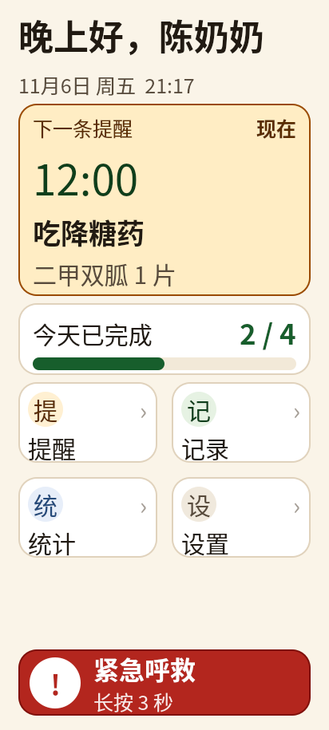

# 颐伴 · 老人提醒端（QML / Android）

面向独居老人的提醒前端，按 [`agent/需求分析.md`](agent/需求分析.md) 与
[`agent/需求扩展与技术路线.md`](agent/需求扩展与技术路线.md) 的适老化约束实现。
界面全部用 QML 编写，**QML 不直接碰数据**：页面只调用 6 个 C++ 门面（ReminderVM /
PlanVM / RecordVM / SyncVM / DeviceVM / ProfileVM）的方法、只读它们的属性。
接口形状、状态机、错误码已冻结在
[`docs/端上接口规范_v1.1.md`](docs/端上接口规范_v1.1.md)，
给后端队友的落点与顺序见 [`docs/后端交接清单.md`](docs/后端交接清单.md)。



## 页面

| 页面 | 说明 |
| --- | --- |
| 首页 | 问候 + 日期时间、下一条提醒大卡、今日完成进度、2×2 四个大入口、底部 SOS 长按条；初始无数据时显示引导 |
| 提醒 | 今日提醒列表；完成 / 推迟 / 撤销 / 删除；新建入口；空数据时显示空态 |
| 新建提醒 | 名称、时间（±15 分钟 + 常用时刻）、剂量、备注、重复方式；校验名称与已过时间 |
| 记一笔 | 喝水 8 杯、睡眠起止、活动累计；一键记录，不需要打字 |
| 统计 | 近 7 天 / 近 30 天；完成率、连续天数、漏做次数、Canvas 柱状图、语音播报总结 |
| 设置 | 三档字号、语音播报、夜间安静、演示模式开关、家人电话、配对状态、看护人后台入口、演示工具 |
| 看护人验证 | 必须照抄“我是看护人”五个字；60 秒未完成自动回主界面；上下两个退出键 |
| 管理后台 | 修改紧急联系人、服务器地址、查看同步状态；仅验证成功后进入 |
| 全屏提醒 | 深锈红渐变、大时间、药名/剂量/备注、2 分钟后通知家人、112dp 确认按钮、稍后 10 分钟、再听一遍 |
| 紧急呼救 | 首页长按 3 秒 → 5 秒倒计时可取消 → 已通知家人 |

## 演示模式

应用启动时是**空白真实数据**：没有提醒、没有记录、没有联系人姓名。
设置页的“演示模式 → 使用演示数据”开关打开后，才切换到陈奶奶的 4 条提醒、2 条已完成、
3 杯水、睡眠和活动记录；关掉开关回到原来的真实数据。

- 真实域与演示域各保存一份完整快照（计划、occurrence、记录、事件、档案）；
- 切换时先保存当前域，再载入目标域，并用目标域的 occurrence 重建今日列表，状态不会串；
- “恢复演示数据”只重置演示域，真实数据保持不动；“演示工具”也只在演示模式显示；
- 演示模式的改动不会写回真实域，真实域在演示模式期间完全冻结。

更多截图在 [`screenshots/`](screenshots/)：

- [提醒列表](screenshots/02-reminders.png)
- [新建提醒](screenshots/03-add-reminder.png)
- [记一笔](screenshots/04-record.png)
- [统计](screenshots/05-stats.png)
- [设置](screenshots/06-settings.png)
- [全屏到点提醒](screenshots/07-reminder-fullscreen.png)
- [紧急呼救](screenshots/08-sos-call.png)
- [今日完成后显示明天](screenshots/10-next-day.png)
- [看护人验证](screenshots/11-caregiver-gate.png)
- [管理后台](screenshots/12-admin.png)
- [设置页底部的看护人入口](screenshots/13-settings-admin.png)
- [演示模式下的首页](screenshots/14-demo-home.png)
- [设置页的演示模式开关](screenshots/15-demo-switch.png)

> 01 / 02 / 05 是默认的空白真实数据；其余带数据的页面截图是在设置里打开“演示模式”后拍摄的。

## 运行

桌面预览（需要 Qt 6.7+，含 QtQuick.Controls / QtTextToSpeech / QtSql / QtNetwork）：

```bash
cmake -S . -B build-desktop -DCMAKE_PREFIX_PATH=/opt/Qt/6.11.1/gcc_64
cmake --build build-desktop -j6
./build-desktop/yiban_android_app
```

单元测试（facade 契约：状态机、ID 编码、错误码、事件去重）：

```bash
cmake -S . -B build-verify -DCMAKE_BUILD_TYPE=Release \
      -DCMAKE_PREFIX_PATH=/opt/Qt/6.11.1/gcc_64 -DBUILD_TESTING=ON
cmake --build build-verify --target tst_app_core -j6
QT_QPA_PLATFORM=offscreen ./build-verify/tests/tst_app_core
```

Android APK（Qt 6.11.1 Android arm64 kit，需 SDK/NDK 与 JDK）：

```bash
cmake -S . -B build -DCMAKE_TOOLCHAIN_FILE=/opt/Qt/6.11.1/android_arm64_v8a/lib/cmake/Qt6/qt.toolchain.cmake \
      -DQT_HOST_PATH=/opt/Qt/6.11.1/gcc_64 -DBUILD_TESTING=OFF
cmake --build build --target apk -j6
# 产物：build/android-build/yiban_android_app.apk
```

`AUTO_INSTALL_APK` 默认关闭；需要构建后自动 `adb install -r` 时加
`-DAUTO_INSTALL_APK=ON`。

> 本机沙箱中 `~/.gradle` 与 `~/.android` 不可写，构建时临时把
> `GRADLE_USER_HOME` / `ANDROID_USER_HOME` 指到工作区即可；正常开发机不需要。

静态检查：

```bash
/opt/Qt/6.11.1/gcc_64/bin/qmllint -s qml/*.qml   # 只看语法错误
```

> 单文件模式解析不到 qmldir 里的 facade 单例，会报一批 `missing-property` / `unqualified`
> 的误报；运行时以离屏启动无告警为准。

离屏截图（用于回归检查每个页面，不需要显示器；钩子只在 `YIBAN_DEV_SHOTS` 构建里生效）：

```bash
cmake -S . -B build-shots -DCMAKE_BUILD_TYPE=Debug \
      -DCMAKE_PREFIX_PATH=/opt/Qt/6.11.1/gcc_64 -DCMAKE_CXX_FLAGS=-DYIBAN_DEV_SHOTS
cmake --build build-shots -j6

QT_QPA_PLATFORM=offscreen QT_QUICK_BACKEND=software \
  YIBAN_SHOT=$PWD/screenshots/01-home.png YIBAN_SHOT_DELAY=1600 YIBAN_PAGE=home \
  ./build-shots/yiban_android_app

# YIBAN_PAGE:          home / reminders / add / record / stats / settings
# YIBAN_SHOT_OVERLAY:  reminder（全屏到点提醒）/ call（呼救倒计时）
```

## 适老化设计

### 1. 字体大且可调

所有字号集中在 [`qml/Theme.qml`](qml/Theme.qml)，禁止在页面里逐处写死。默认档位为
115%，三档分别为 100% / 115% / 130%：

| 语义 | 基准 px（100%） | 默认实际 px（115%） |
| --- | ---: | ---: |
| display（提醒时间） | 68 | 78 |
| hero（统计数字） | 46 | 53 |
| title | 38 | 44 |
| heading（卡片标题） | 30 | 35 |
| body（正文） | 26 | 30 |
| label（辅助说明） | 22 | 25 |
| button | 28 | 32 |

设置页切换字号会改 `theme.scaleLevel`，所有 `theme.px()` 与字体绑定一起重算，
不需要重启。`AppText` 统一处理字体、颜色、换行与行高（`lineHeight: 0.9`，
抵消 Noto Sans CJK 偏大的自然行高，避免大字号把卡片撑破）。

### 2. 对比度

主色板与实测 WCAG 对比度（[`qml/Theme.qml`](qml/Theme.qml)）：

| 组合 | 对比度 |
| --- | ---: |
| 正文 `#211A12` / 米白 `#FAF4E8` | 15.7:1 |
| 次要文字 `#584B3C` / 米白 | 7.7:1 |
| 主色 `#175E2C` / 白 | 7.9:1 |
| 提醒正文 `#FFF4E2` / 深锈红 `#3B1002` | 15.3:1 |
| 提醒强调 `#FFC24B` / 深锈红 | 10.4:1 |
| 白 / 危险红 `#B3261E` | 6.5:1 |

全部高于 WCAG AA 的 4.5:1，正文接近 AAA。状态不只靠颜色，同时用文字标签
（已确认 / 待确认 / 已推迟 / 已错过 / 已通知家人）。

### 3. 不容易误触

- **点击目标**：普通可点区域 ≥ 64dp；按钮 72dp；主按钮 88dp；提醒确认按钮 112dp。
- **防连点**：所有按钮 400ms 去抖；开关 300ms 去抖；重复点不会重复提交。
- **二次确认**：删除提醒、恢复演示数据、给家人拨号都弹大按钮确认框。
- **5 秒撤销**：确认提醒、喝水记录后底部出现撤销条，5 秒内可反悔。
- **SOS 两道闸**：首页 SOS 必须长按 3 秒（带进度条），松手即取消；随后 5 秒倒计时，
  期间可点“取消呼救”。
- **提醒页不可误关**：到点提醒全屏显示，返回键被拦截，必须选“我已吃好”或“稍后”。
- **稍后限次**：每条提醒最多推迟 3 次，避免一直推迟导致漏服。
- **布局防误触**：首页只保留 4 个 2×2 大入口，单屏选项不超过 4 个；导航与操作按钮
  全宽或半宽，避免小图标并排。
- **看护人后台两道门槛**：入口放在设置页最底部；进入后必须先到验证页，照抄“我是看护人”
  五个字。60 秒没输完自动回主界面，点退出或按返回键也直接退出。

### 4. 事件提醒醒目

- 全屏深锈红渐变 + 呼吸琥珀描边，和日常米白界面形成强反差。
- 默认 115% 下约 60px 大时间、44px 药名，剂量/备注分层；主按钮白底深字，112dp 高。
- 打开时语音播报（`QtTextToSpeech`，中文），可点“再听一遍”。
- 2 分钟未处理，自动 toast 并标记“已通知家人”；底部显示剩余推迟次数。
- 提醒数据到点由 `AppCore` 每秒检查（时间源可换成服务端偏移），真实接入后改为推送 + 轮询兜底。

### 5. 老人操作路径

- 确认吃药：看到全屏提醒 → 点“✓ 我已吃好” → 5 秒内可撤销。
- 推迟：点“稍后 10 分钟” → 到点再次全屏提醒（最多 3 次）。
- 记录喝水：首页“记一笔” → “＋ 我喝了一杯水” → 5 秒内可撤销。
- 呼救：长按底部 SOS 3 秒 → 5 秒内可取消 → 自动通知家人。

## 结构

```text
qml/
  Main.qml              ApplicationWindow、StackView、覆盖层、Toast/UndoBar、返回键，
                         统一接 VM 的 commandRejected/toast/reminderDue
  Theme.qml             字号/间距/触控尺寸/色板，全局 uiScale
  Fmt.qml               纯展示函数（时间、问候、统计汇总），pragma Singleton
  Undo.qml              5 秒撤销条的 UI 计时，pragma Singleton
  Notify.qml            页面级轻提示通道，pragma Singleton
  HomePage.qml          首页
  RemindersPage.qml     今日提醒列表
  AddReminderPage.qml   新建提醒（构造冻结的 rule JSON）
  RecordPage.qml        喝水/睡眠/活动记录
  StatsPage.qml         7/30 天统计
  SettingsPage.qml      设置与演示工具
  CaregiverGatePage.qml 看护人验证缓冲页（60 秒超时）
  AdminPage.qml         看护人管理后台（联系人、网络、同步）
  ReminderScreen.qml    全屏到点提醒
  CallScreen.qml        呼救倒计时
  SosButton.qml         长按 3 秒 SOS
  AppButton / AppText / NavTile / NavRow / HeaderBar / StateChip
  Field / ToggleRow / ConfirmDialog / Toast / UndoBar / BarChart
src/vm/
  reminder_vm.*         ReminderVM：today/current/confirm/snooze/undo/escalate/sos
  plan_vm.*             PlanVM：plans/todaySummary/createPlan/updatePlan/deletePlan
  record_vm.*           RecordVM：records/stats7/stats30/addWater/markSleepStart/...
  sync_vm.*             SyncVM：syncState/lastSyncTs/pendingCount/retrySync
  device_vm.*           DeviceVM：pair/speak/sos/enterKiosk/TTS
  profile_vm.*          ProfileVM：老人与家人档案
  app_core.*            端上数据核心（demo 内存实现，B1 换 SQLite + 状态机）
  facade_errors.h       错误码 → 中文文案
src/comm/
  http_client.*         唯一 HTTP 落点（当前只有离线实现，B2 补真实客户端）
tests/
  tst_app_core.cpp      facade 契约单测（15 例）
docs/
  端上接口规范_v1.1.md   ★ 冻结的接口/形状/状态机/错误码
  后端交接清单.md       给 B1/B2 的逐文件落点与顺序
  fixtures/             HTTP 请求/响应样例
screenshots/            设计验收截图
```
## 接口与分层

页面只表达意图，数据与状态全在门面之后：

```text
qml 页面 ──调用──▶ ReminderVM / PlanVM / RecordVM / SyncVM / DeviceVM / ProfileVM
                            │
                            ▼
                    AppCore（状态机 + 存储 + 事件队列）  ←── HttpClient（唯一网络出口）
```

| UI 动作 | 门面调用 | 后端落点 |
| --- | --- | --- |
| 今日提醒 / 下一条 | `ReminderVM.today` / `ReminderVM.current`；今天完成后用 `ReminderVM.next` 显示明天 | `GET /v1/state?since=` |
| 完成 / 推迟 / 撤销 | `ReminderVM.confirm/snooze/undo` | `POST /v1/events` |
| 通知家人 | `ReminderVM.escalate` | `POST /v1/events` + `POST /v1/alarm` |
| 新建 / 修改 / 删除提醒 | `PlanVM.createPlan/updatePlan/deletePlan` | `POST/PATCH/DELETE /v1/plans` |
| 喝水 / 睡眠 / 活动 | `RecordVM.addWater/markSleepStart/addActivity` | `POST /v1/records` |
| 统计 | `RecordVM.stats7/stats30`（端上从 occurrence 历史算） | 本地计算，`GET /v1/state` 提供原料 |
| 呼救 | `ReminderVM.sos` / `DeviceVM.sos` | `POST /v1/alarm`（`source:"manual"`） |
| 配对 | `DeviceVM.pair` + `ProfileVM.applyProfile` | `POST /v1/pair` |
| 同步状态 | `SyncVM.syncState/lastSyncTs/pendingCount/retrySync` | `GET /v1/state?since=` 的 `next_seq` 游标 |

三条约定（详见 [`docs/端上接口规范_v1.1.md`](docs/端上接口规范_v1.1.md)）：

- 方法只发意图、不返回值；失败走 `commandRejected(code, message)`，由 Main 统一弹 Toast。
- `event_id = uuid5(occurrenceId:action:ts:seq)`；连点由状态机拒绝，不靠 id 去重。
- `occurrenceId` 端上生成：`planId * 1e9 + (julianDay % 1e7) * 100 + 当天序号`。

## 已知边界

- 锁屏可见 / 锁屏全屏提醒需要 Android 前台服务 + `full-screen intent`，QML 层无法单独完成；
  当前实现是应用内全屏。
- 无 TalkBack 读屏支持：Qt QML 的无障碍树在 Android 上能力有限；本设计以大字、高对比、
  语音播报为主要补偿手段。
- 真实数据与演示数据都只存在内存；演示数据由 `AppCore::seedDemo()` 预置，启动时只生成演示快照，
  真实数据域默认为空。切换演示模式只在两个内存快照间切换，不会互相覆盖；重启应用后都恢复默认。
  设置项（字号、语音开关）、管理后台里改的紧急联系人和服务器地址也只保存在内存，
  重启后恢复默认值；真实版需要 SQLite / 后端 profile / 设备配置接口。
- 语音依赖设备 TTS 引擎；`AndroidManifest.xml` 已加 Android 11+ 的 `TTS_SERVICE` 查询声明。
- 新建页面向老人只暴露“每天 / 每周 / 每月 / 仅一次”四种常用重复（对应规则 JSON 见规范 §6）；
  interval / course / meal_offset 不进端上，更适合放到照护者端或后续“高级选项”。
- 应用为竖屏锁定；若后续要做平板/横屏，需要重新排 2×2 入口与统计图。
- “特大字号”下部分页面（首页、设置、表单）需要上下滑动才能看到全部内容；这是为了保证字号不缩小、不裁切而做的取舍。默认“大字号”下首页四个入口和 SOS 仍在一屏内。

## 验证

- `qmllint -s qml/*.qml`：无语法错误（facade 单例的误报见“运行”一节说明）。
- `tests/tst_app_core`：16 例全绿（状态机、ID 编码、错误码、事件去重、演示/真实数据域隔离）；
  `CTest` 集成，`BUILD_TESTING=ON`（默认）即可跑。
- 桌面 `build-desktop` 编译通过，离屏启动无 QML 运行时错误。
- Android `build` 的 `apk` 目标构建通过，产物 `build/android-build/yiban_android_app.apk`。
- 14 张页面截图 412×915，由开发构建的截图钩子生成（`YIBAN_DEV_SHOTS=ON`，
  环境变量 `YIBAN_SHOT` / `YIBAN_PAGE` / `YIBAN_SHOT_OVERLAY` / `YIBAN_DEMO`），提交前人工看过每页。
