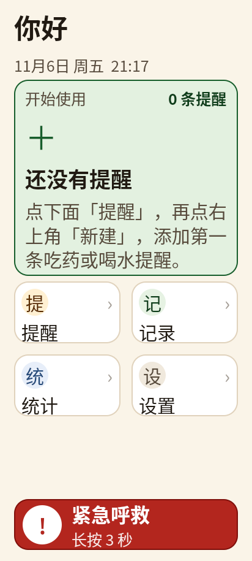

# 一伴 · 老人提醒端（QML / Android）

面向独居老人的提醒前端，按 [`agent/需求分析.md`](agent/需求分析.md) 与
[`agent/需求扩展与技术路线.md`](agent/需求扩展与技术路线.md) 的适老化约束实现。
界面全部用 QML 编写，后端接口按 [`agent/2_手机端_对接契约_v0.1.md`](agent/2_手机端_对接契约_v0.1.md)
的模型做了可交互的本地 Mock，方便先验证交互，再接真实服务。



## 页面

| 页面 | 说明 |
| --- | --- |
| 首页 | 问候 + 日期时间、下一条提醒大卡、今日完成进度、2×2 四个大入口、底部 SOS 长按条 |
| 提醒 | 4 条今日提醒；完成 / 推迟 / 撤销 / 删除；新建入口 |
| 新建提醒 | 名称、时间（±15 分钟 + 常用时刻）、剂量、备注、重复方式；校验名称与已过时间 |
| 记一笔 | 喝水 8 杯、睡眠起止、活动累计；一键记录，不需要打字 |
| 统计 | 近 7 天 / 近 30 天；完成率、连续天数、漏做次数、Canvas 柱状图、语音播报总结 |
| 设置 | 三档字号、语音播报、夜间安静、家人电话、配对状态、演示工具 |
| 全屏提醒 | 深锈红渐变、大时间、药名/剂量/备注、2 分钟后通知家人、112dp 确认按钮、稍后 10 分钟、再听一遍 |
| 紧急呼救 | 首页长按 3 秒 → 5 秒倒计时可取消 → 已通知家人 |

更多截图在 [`screenshots/`](screenshots/)：

- [提醒列表](screenshots/02-reminders.png)
- [新建提醒](screenshots/03-add-reminder.png)
- [记一笔](screenshots/04-record.png)
- [统计](screenshots/05-stats.png)
- [设置](screenshots/06-settings.png)
- [全屏到点提醒](screenshots/07-reminder-fullscreen.png)
- [紧急呼救](screenshots/08-sos-call.png)
- [确认后撤销：回到“待确认”，完成/推迟按钮仍可用](screenshots/09-undo-state.png)

## 运行

桌面预览（需要 Qt 6.7+，含 QtQuick.Controls / QtTextToSpeech）：

```bash
cmake -S . -B build-desktop -DCMAKE_PREFIX_PATH=/opt/Qt/6.11.1/gcc_64 -DBUILD_TESTING=OFF
cmake --build build-desktop -j6
./build-desktop/yiban_android_app
```

Android APK（Qt 6.11.1 Android arm64 kit，需 SDK/NDK 与 JDK）：

```bash
cmake -S . -B build -DCMAKE_TOOLCHAIN_FILE=/opt/Qt/6.11.1/android_arm64_v8a/lib/cmake/Qt6/qt.toolchain.cmake \
      -DQT_HOST_PATH=/opt/Qt/6.11.1/gcc_64 -DBUILD_TESTING=OFF
cmake --build build --target apk -j6
# 产物：build/android-build/yiban_android_app.apk
```

`AUTO_INSTALL_APK` 默认关闭；需要构建后自动 `adb install -r` 时加
`-DAUTO_INSTALL_APK=ON`。

> 本机沙箱中 `~/.gradle` 与 `~/.android` 不可写，构建时临时把
> `GRADLE_USER_HOME` / `ANDROID_USER_HOME` 指到工作区即可；正常开发机不需要。

静态检查：

```bash
/opt/Qt/6.11.1/gcc_64/bin/qmllint qml/*.qml
```

离屏截图（用于回归检查每个页面，不需要显示器）：

```bash
QT_QPA_PLATFORM=offscreen QT_QUICK_BACKEND=software \
/opt/Qt/6.11.1/gcc_64/bin/qml tools/ui-preview/Shot.qml -- \
  --out=/tmp/home.png --page=home
# page: home / reminders / add / record / stats / settings / reminder / call / main
# main 可加 --nav=stats 验证 StackView 导航
```

## 适老化设计

### 1. 字体大且可调

所有字号集中在 [`qml/Theme.qml`](qml/Theme.qml)，禁止在页面里逐处写死。默认档位为
115%，三档分别为 100% / 115% / 130%：

| 语义 | 基准 px（100%） | 默认实际 px（115%） |
| --- | ---: | ---: |
| display（提醒时间） | 68 | 78 |
| hero（统计数字） | 46 | 53 |
| title | 38 | 44 |
| heading（卡片标题） | 30 | 35 |
| body（正文） | 26 | 30 |
| label（辅助说明） | 22 | 25 |
| button | 28 | 32 |

设置页切换字号会改 `theme.scaleLevel`，所有 `theme.px()` 与字体绑定一起重算，
不需要重启。`AppText` 统一处理字体、颜色、换行与行高（`lineHeight: 0.9`，
抵消 Noto Sans CJK 偏大的自然行高，避免大字号把卡片撑破）。

### 2. 对比度

主色板与实测 WCAG 对比度（[`qml/Theme.qml`](qml/Theme.qml)）：

| 组合 | 对比度 |
| --- | ---: |
| 正文 `#211A12` / 米白 `#FAF4E8` | 15.7:1 |
| 次要文字 `#584B3C` / 米白 | 7.7:1 |
| 主色 `#175E2C` / 白 | 7.9:1 |
| 提醒正文 `#FFF4E2` / 深锈红 `#3B1002` | 15.3:1 |
| 提醒强调 `#FFC24B` / 深锈红 | 10.4:1 |
| 白 / 危险红 `#B3261E` | 6.5:1 |

全部高于 WCAG AA 的 4.5:1，正文接近 AAA。状态不只靠颜色，同时用文字标签
（已确认 / 待确认 / 已推迟 / 已错过 / 已通知家人）。

### 3. 不容易误触

- **点击目标**：普通可点区域 ≥ 64dp；按钮 72dp；主按钮 88dp；提醒确认按钮 112dp。
- **防连点**：所有按钮 400ms 去抖；开关 300ms 去抖；重复点不会重复提交。
- **二次确认**：删除提醒、恢复演示数据、给家人拨号都弹大按钮确认框。
- **5 秒撤销**：确认提醒、喝水记录后底部出现撤销条，5 秒内可反悔。
- **SOS 两道闸**：首页 SOS 必须长按 3 秒（带进度条），松手即取消；随后 5 秒倒计时，
  期间可点“取消呼救”。
- **提醒页不可误关**：到点提醒全屏显示，返回键被拦截，必须选“我已吃好”或“稍后”。
- **稍后限次**：每条提醒最多推迟 3 次，避免一直推迟导致漏服。
- **布局防误触**：首页只保留 4 个 2×2 大入口，单屏选项不超过 4 个；导航与操作按钮
  全宽或半宽，避免小图标并排。

### 4. 事件提醒醒目

- 全屏深锈红渐变 + 呼吸琥珀描边，和日常米白界面形成强反差。
- 默认 115% 下约 60px 大时间、44px 药名，剂量/备注分层；主按钮白底深字，112dp 高。
- 打开时语音播报（`QtTextToSpeech`，中文），可点“再听一遍”。
- 2 分钟未处理，自动 toast 并标记“已通知家人”；底部显示剩余推迟次数。
- 提醒数据到点由 `MockBackend.tick()` 每秒检查，真实接入时改为后端推送/轮询。

### 5. 老人操作路径

- 确认吃药：看到全屏提醒 → 点“✓ 我已吃好” → 5 秒内可撤销。
- 推迟：点“稍后 10 分钟” → 到点再次全屏提醒（最多 3 次）。
- 记录喝水：首页“记一笔” → “＋ 我喝了一杯水” → 5 秒内可撤销。
- 呼救：长按底部 SOS 3 秒 → 5 秒内可取消 → 自动通知家人。

## 结构

```text
qml/
  Main.qml              ApplicationWindow、StackView、覆盖层、Toast/UndoBar、返回键
  Theme.qml             字号/间距/触控尺寸/色板，全局 uiScale
  MockBackend.qml       演示数据与动作（对齐对接契约的字段与状态）
  HomePage.qml          首页
  RemindersPage.qml     今日提醒列表
  AddReminderPage.qml   新建提醒
  RecordPage.qml        喝水/睡眠/活动记录
  StatsPage.qml         7/30 天统计
  SettingsPage.qml      设置与演示工具
  ReminderScreen.qml    全屏到点提醒
  CallScreen.qml        呼救倒计时
  SosButton.qml         长按 3 秒 SOS
  AppButton / AppText / NavTile / NavRow / HeaderBar / StateChip
  Field / ToggleRow / ConfirmDialog / Toast / UndoBar / BarChart
tools/ui-preview/Shot.qml   离屏截图工具
screenshots/                设计验收截图
```

## 与后端契约的对应

当前 [`qml/MockBackend.qml`](qml/MockBackend.qml) 用内存数组模拟，方法名与契约动作一一对应，
替换成真实 `QObject` 时页面绑定不需要改：

| UI 动作 | Mock 方法 | 契约接口 |
| --- | --- | --- |
| 今日提醒列表 | `sortedReminders` / `tick()` | `GET /occurrences` |
| 完成 / 推迟 | `confirmOccurrence` / `snoozeOccurrence` | `POST /occurrences/{id}/events` |
| 新建提醒 | `addReminder` | `POST /plans` |
| 删除提醒 | `removeReminder` | `PATCH /plans/{id}` |
| 喝水/睡眠/活动 | `addWater` / `markSleepStart` / `addActivity` | `POST /records` |
| 统计 | `stats7` / `stats30` / `statsSummary` | `GET /stats` |
| 通知家人 | `notifyCaregiver` | `POST /occurrences/{id}/events`（escalate） |
| 呼救 | `CallScreen` + `notifyCaregiver` | `GET /alerts` / 事件上报 |

真实接入时保留“动作 → 等后端返回 → 重新拉取列表”的顺序，不在客户端直接改最终状态；
`event_id` 用 `uuid5(occurrence_id + action + client_ts)`，重试时 `client_ts` 不变。

## 已知边界

- 锁屏可见 / 锁屏全屏提醒需要 Android 前台服务 + `full-screen intent`，QML 层无法单独完成；
  当前实现是应用内全屏。
- 无 TalkBack 读屏支持：Qt QML 的无障碍树在 Android 上能力有限；本设计以大字、高对比、
  语音播报为主要补偿手段。
- 演示数据只存在内存，重启恢复默认；设置项也未做持久化。
- 语音依赖设备 TTS 引擎；`AndroidManifest.xml` 已加 Android 11+ 的 `TTS_SERVICE` 查询声明。
- 新建页面向老人只暴露“每天 / 每周 / 每月 / 仅一次”四种常用重复；契约里的 interval / course / meal_offset 更适合放到照护者端或后续“高级选项”。
- 应用为竖屏锁定；若后续要做平板/横屏，需要重新排 2×2 入口与统计图。
- “特大字号”下部分页面（首页、设置、表单）需要上下滑动才能看到全部内容；这是为了保证字号不缩小、不裁切而做的取舍。默认“大字号”下首页四个入口和 SOS 仍在一屏内。

## 验证

- `qmllint qml/*.qml`：无输出。
- 桌面 `build-desktop` 编译通过，离屏启动无 QML 运行时错误。
- Android `build` 的 `apk` 目标构建通过，产物 `build/android-build/yiban_android_app.apk`。
- 9 张页面截图由 `tools/ui-preview/Shot.qml` 离屏渲染，412×915；其中 `09-undo-state.png` 是“确认后撤销”回归截图。
